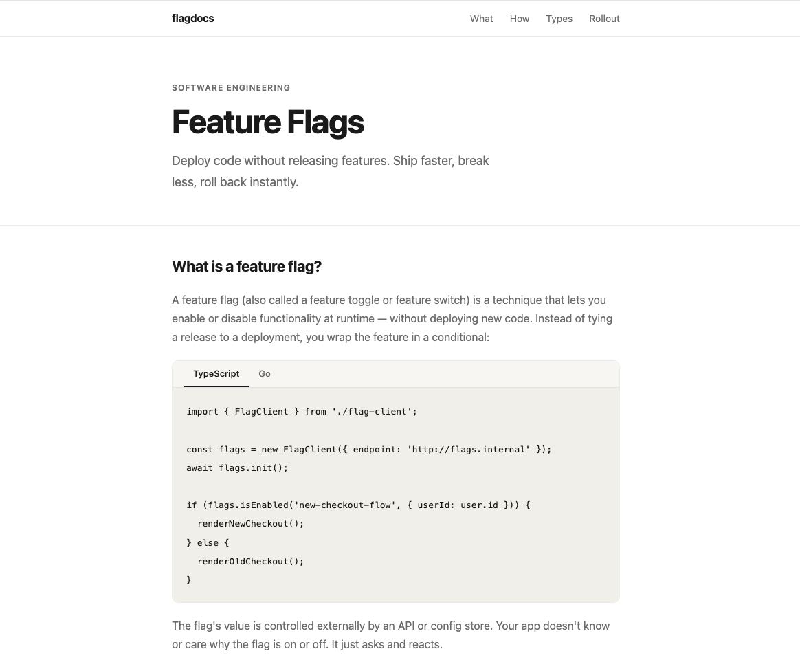
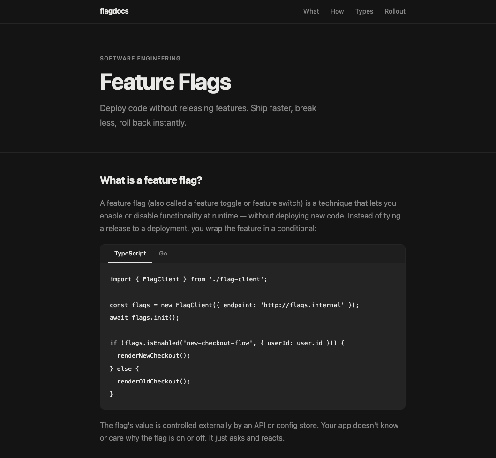
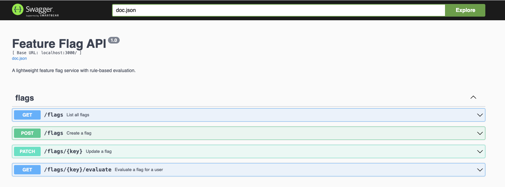

# Service de feature flags

<p align="center">
  <a href="https://github.com/agogte/feature-flag-service/actions/workflows/ci.yml"></a>
  
  
  
  
  
</p>

<p align="center"><a href="README.md">English</a> · <b>Français</b></p>

Une API de feature flags légère avec évaluation par règles (listes de dérogation, ciblage par segment et déploiements progressifs en pourcentage « sticky »), accompagnée d'un site de documentation statique qui illustre le mode clair/sombre grâce à un flag réel.

Voir [DESIGN.md](DESIGN.md) pour l'architecture et le détail du moteur d'évaluation (en anglais).

## Captures d'écran

| Mode clair (flag désactivé) | Mode sombre (flag activé) |
| --- | --- |
|  |  |

Swagger UI :



## Structure du projet

```
api/    API Go (stockage des flags sous sqlite, moteur d'évaluation, docs swagger)
app/    Site de documentation statique qui lit le flag dark-mode et bascule son thème
docker-compose.yml
```

## Lancer le projet

```bash
docker-compose up --build
```

- API : http://localhost:3000 (Swagger UI sur `/swagger/index.html`)
- Application : http://localhost:8080

Les flags sont persistés dans un fichier sqlite `api/data/flags.db` (créé automatiquement au premier lancement). Un flag `dark-mode` est créé au démarrage s'il n'existe pas déjà, l'API est donc utilisable immédiatement sans configuration.

## Référence rapide de l'API

| Méthode | Chemin | Description |
| --- | --- | --- |
| `GET` | `/flags` | Lister tous les flags |
| `POST` | `/flags` | Créer un flag |
| `PATCH` | `/flags/{key}` | Modifier `isEnabled`/`rules`/`description` d'un flag |
| `GET` | `/flags/{key}/evaluate?userId=...` | Évaluer un flag pour un utilisateur |
| `GET` | `/health` | Vérification de disponibilité (interroge la base de données) |
| `GET` | `/metrics` | Nombre de flags, d'évaluations, d'erreurs et uptime |

Exemple : déployer un flag auprès de 100 % des utilisateurs :

```bash
curl -X PATCH http://localhost:3000/flags/dark-mode \
  -H "Content-Type: application/json" \
  -d '{ "isEnabled": true, "rules": [{ "type": "percentage", "rollout": 100 }] }'

curl "http://localhost:3000/flags/dark-mode/evaluate?userId=user_942"
```

Endpoints d'exploitation :

```bash
curl http://localhost:3000/health
# { "status": "Ok", "database": true, "uptimeSeconds": 42 }

curl http://localhost:3000/metrics
# { "flagCount": 2, "evalCount": 17, "errorCount": 1, "uptimeSeconds": 42, "lastError": "...", "lastErrorAt": "..." }
```
